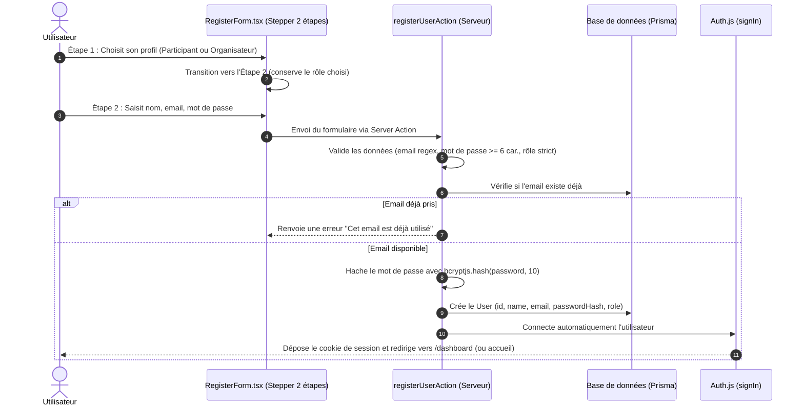
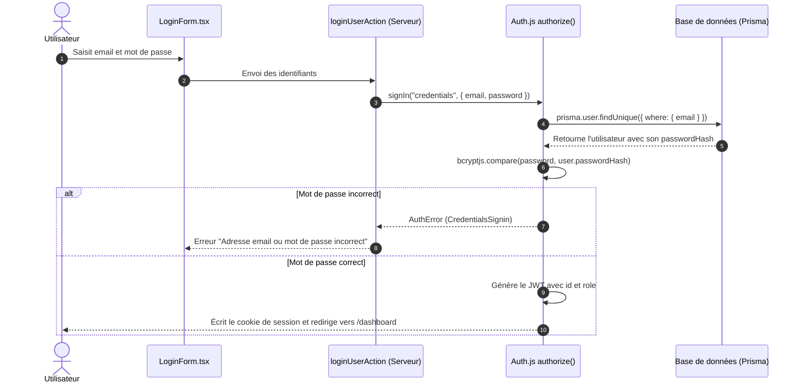

# Guide & Récapitulatif : L'Authentification avec Next.js et Auth.js (v5)

Ce document explique en détail le fonctionnement et la mise en œuvre de l'authentification sur le projet **Event Congo** avec **Next.js (App Router)**, **Auth.js (`next-auth@beta`)**, **Prisma** et **PostgreSQL**.

---

## 1. Vue d'ensemble du fonctionnement

Dans une application web moderne avec Next.js (App Router), il y a deux mondes :
- **Le monde Client (Navigateur)** : affiche l'interface, gère les interactions et la saisie de formulaires.
- **Le monde Serveur (Node.js)** : accède directement à la base de données (Prisma), vérifie les sessions, hache les mots de passe et sécurise les actions.

### Pourquoi Auth.js avec session JWT ?
1. **Paiement simulé & légèreté** : nous utilisons une stratégie de session par **JWT (JSON Web Token)** stocké dans un cookie HTTP chiffré et sécurisé (`httpOnly`).
2. **Persistance automatique** : à chaque rechargement de page, le navigateur renvoie automatiquement ce cookie. Le serveur le déchiffre avec `AUTH_SECRET`, identifie l'utilisateur instantanément sans avoir besoin de faire une requête SQL à chaque clic.
3. **Contrôle des rôles** : le rôle de l'utilisateur (`ATTENDEE` ou `ORGANIZER`) est injecté directement dans le token JWT et la session.

---

## 2. Les fichiers clés de l'architecture

```
├── auth.config.ts                 # Configuration partagée (pages, callbacks Edge/Proxy)
├── auth.ts                        # Configuration complète (Provider Credentials, Prisma, bcryptjs)
├── proxy.ts                       # Proxy Next.js 16 (remplaçant de middleware.ts)
├── app/
│   ├── (auth)/
│   │   ├── login/page.tsx         # Page de connexion
│   │   └── register/page.tsx      # Page d'inscription avec choix du rôle
│   ├── (organizer)/
│   │   └── dashboard/page.tsx     # Route protégée testant la session
│   └── api/auth/[...nextauth]/
│       └── route.ts               # Point d'entrée HTTP d'Auth.js (GET & POST)
├── modules/auth/
│   ├── actions.ts                 # Server Actions ("use server") : register, login, logout
│   ├── queries.ts                 # Lecture et gardes : getCurrentUser(), requireUser(), requirePageRole(), requireRole(), requireOwnership()
│   ├── validation.ts              # Validation des formulaires côté serveur
│   ├── types.ts                   # Types TypeScript
│   └── components/
│       ├── LoginForm.tsx          # Formulaire client de connexion
│       ├── RegisterForm.tsx       # Formulaire client d'inscription
│       └── LogoutButton.tsx       # Bouton client de déconnexion
└── types/
    └── next-auth.d.ts             # Extension des types Auth.js pour inclure id et role
```

---

## 3. Détail des composants et de leur rôle

### A. `auth.config.ts` (Configuration légère et compatible Edge)
Ce fichier configure :
- La page personnalisée de connexion : `pages: { signIn: "/login" }`.
- La stratégie de session : `session: { strategy: "jwt" }`.
- Le callback `authorized` : décide si une requête HTTP a le droit d'accéder à une route (ex: si l'utilisateur visite `/dashboard` sans être connecté, il est redirigé vers `/login`).
- Les callbacks `jwt` et `session` : ajoutent les champs personnalisés (`id`, `role`) dans le jeton et l'objet `session.user`.

### B. `auth.ts` (Le moteur d'authentification)
Ce fichier enrichit `auth.config.ts` avec les fonctionnalités nécessitant un environnement serveur complet :
- Provider **Credentials** : permet la connexion par email et mot de passe.
- Fonction `authorize(credentials)` :
  1. Reçoit l'email et le mot de passe saisis.
  2. Cherche l'utilisateur en base de données avec `prisma.user.findUnique`.
  3. Compare le mot de passe en clair avec le hash stocké grâce à `bcryptjs.compare`.
  4. Si valide, renvoie l'objet utilisateur (`id`, `name`, `email`, `role`). Si invalide, renvoie `null`.
- Exporte `{ handlers, auth, signIn, signOut }`.

### C. `proxy.ts` (Next.js 16 Proxy)
Dans Next.js 16, `middleware.ts` a été renommé en `proxy.ts`. Il s'exécute avant le rendu des pages :
- Il vérifie la présence du cookie de session.
- Il applique automatiquement la fonction `authorized` définie dans `auth.config.ts`.
- Si un visiteur non connecté tente d'accéder à `/dashboard`, `/organizer` ou `/mes-tickets`, le proxy le redirige immédiatement vers `/login`.

---

## 4. Les flux pas à pas

### Flux 1 : Inscription d'un nouvel utilisateur (`/register`)

L'inscription utilise un **stepper en 2 étapes** pour éliminer le défilement vertical et offrir une expérience utilisateur fluide :
- **Étape 1** : Sélection du type de compte (cartes interactives pour **Participant** ou **Organisateur**).
- **Étape 2** : Saisie des coordonnées (Nom, Email, Mot de passe, Confirmation) avec possibilité de revenir à l'étape 1 en un clic.



### Flux 2 : Connexion d'un utilisateur (`/login`)



### Flux 3 : Déconnexion

1. L'utilisateur clique sur le bouton **Se déconnecter** (`<LogoutButton />`).
2. Le Server Action `logoutUserAction()` appelle `signOut({ redirectTo: "/login" })`.
3. Auth.js supprime le cookie de session du navigateur.
4. L'utilisateur est redirigé vers la page `/login`.

---

## 5. Règle d'or : La défense en profondeur

Dans ce projet, la sécurité ne repose pas uniquement sur le proxy :
1. **Au niveau du Proxy (`proxy.ts`)** : bloque les requêtes non authentifiées avant même d'entamer le rendu de la page.
2. **Au niveau des Server Components (`queries.ts`)** : les pages sensibles appellent `await requireUser()` ou `await requirePageRole(["ORGANIZER"])`. Si la session est invalide, la redirection s'opère immédiatement.
3. **Au niveau des Server Actions (`actions.ts`)** : chaque action d'écriture vérifie le rôle et la propriété de la ressource avec `requireRole(session, "ORGANIZER")` ou `requireOwnership(session, resource.organizerId)`. Une action ne redirige pas : elle renvoie `{ success: false, status: 403, error }`.
4. **Attribution des rôles** : seuls les rôles `ATTENDEE` et `ORGANIZER` sont acceptés à l'inscription. Le rôle `ADMIN` ne peut jamais être attribué par formulaire.

### Vérifier le rôle dans une Server Action

```ts
import { getCurrentSession, requireRole } from "@/modules/auth/queries";

export async function createEventAction(formData: FormData) {
  const session = await getCurrentSession();
  const authz = requireRole(session, "ORGANIZER");
  if (!authz.ok) {
    return { success: false, status: authz.status, error: authz.error };
  }

  // authz.user.id est l'utilisateur vérifié côté serveur :
  // ne jamais lire organizerId depuis le formulaire.
}
```

Pour une modification ou une suppression, `requireOwnership(session, event.organizerId)` vérifie à la fois le rôle et le fait que `organizerId === session.user.id`. Toute tentative d'un participant, ou d'un organisateur sur la ressource d'un autre, renvoie une erreur 403.

---

## 6. Comptes de test disponibles

| Rôle | Email | Mot de passe | Accès |
|---|---|---|---|
| **Organisateur** | `organisateur@example.com` | `Organizer123!` | `/dashboard`, création d'événements |
| **Participant** | `participant@example.com` | `Participant123!` | `/dashboard`, achat et tickets |

Pour peupler la base de données avec ces comptes :
```bash
npx prisma db seed
```
